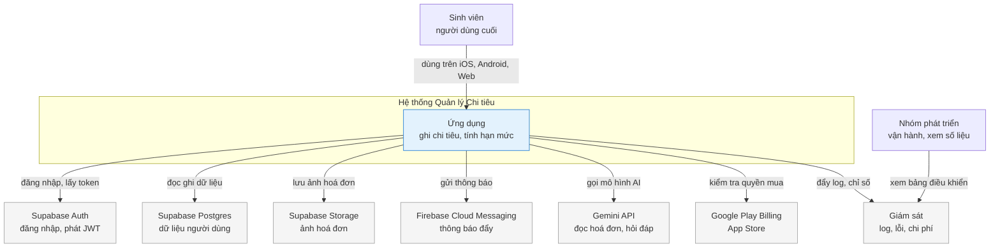
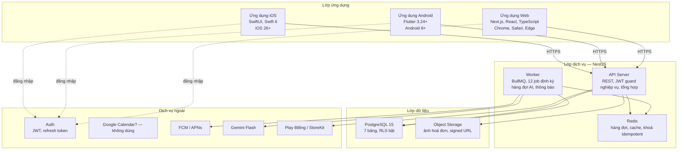
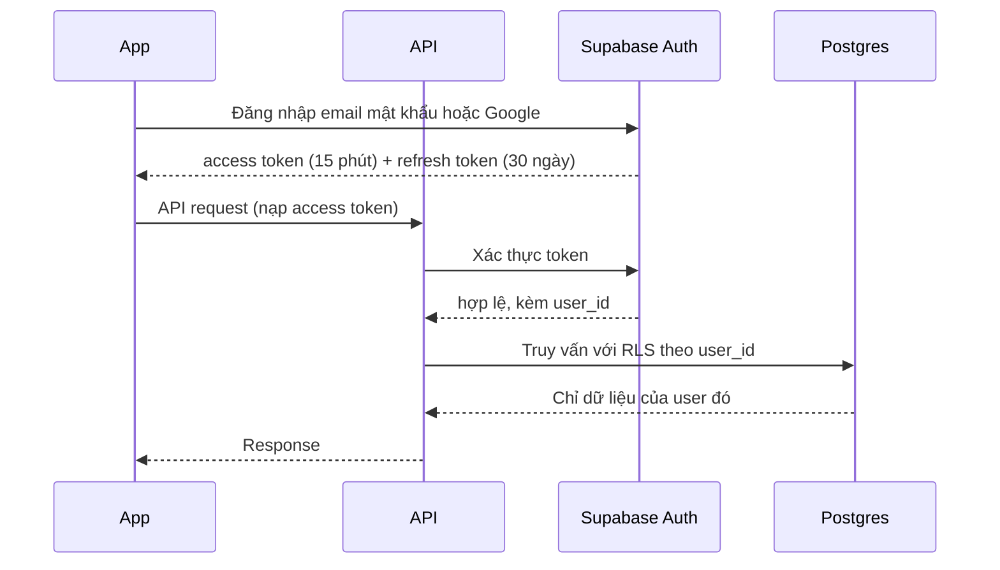

# 00 — Kiến trúc hệ thống

Tài liệu gốc của bộ thiết kế. Mọi tài liệu khác (`01`–`07`) triển khai chi tiết nội dung ở đây.

Phiên bản 2.0 — 2026-11-16. Thay thế bản 1.1 (một nền tảng Flutter cho cả iOS và Android).

---

## 1. Mục tiêu và ràng buộc

### Mục tiêu kiến trúc

| # | Mục tiêu | Cách đo |
|---|---|---|
| M1 | Ghi một khoản chi khi không có mạng | Tắt wifi + 4G, ghi 5 khoản, mở lại app vẫn còn đủ |
| M2 | Không mất dữ liệu khi đồng bộ | Đồng bộ 1.000 lượt liên tiếp, đối chiếu checksum hai đầu khớp |
| M3 | Không tạo bản ghi trùng | Chạy lại cùng một gói tin 10 lần, số bản ghi không đổi |
| M4 | Ba nền tảng dùng chung một nguồn sự thật | Web, iOS, Android đọc cùng dữ liệu, số liệu khớp từng đồng |
| M5 | Đổi nhà cung cấp AI không sửa client | Chỉ sửa cấu hình server, không phát hành bản mới |
| M6 | Chi phí hạ tầng giai đoạn đầu dưới 500.000đ/tháng | Hoá đơn thực tế ba tháng đầu |

### Ràng buộc

| Loại | Ràng buộc | Hệ quả lên kiến trúc |
|---|---|---|
| Nhân lực | 1 người làm kỹ thuật, part-time | Không viết native cho nhiều nền tảng; không tự dựng backend từ đầu |
| Thời gian | 10 tuần tới ngày nộp | MVP phải chạy được trước tuần 8 |
| Tiền | 0đ hạ tầng giai đoạn đầu | Chỉ dùng gói miễn phí; không thuê VPS riêng |
| Pháp lý | Không có giấy phép trung gian thanh toán | App **không giữ tiền**, không nạp, không rút, không liên kết ngân hàng |
| Thị trường | Người dùng chủ yếu Android tầm trung | Thiết kế trên 360dp trước, không thiết kế trên iPhone rồi thu nhỏ |

### Ngoài phạm vi (không thiết kế ở bản này)

Mục tiêu tiết kiệm — đã loại bỏ vì con số không kiểm chứng được (người dùng tự gõ, không gắn với giao dịch thật). Đọc tiền qua API ngân hàng — Việt Nam chưa có chuẩn Open Banking mở. Đọc thông báo hệ điều hành — bị ROM Trung Quốc giết dịch vụ nền.

---

## 2. Quyết định nền tảng đã chốt

| # | Quyết định | Ngày | Hệ quả |
|---|---|---|---|
| Q1 | Không lưu `balance` trong `wallets`; số dư luôn tính từ giao dịch | 2026-11-13 | `transactions` là nguồn sự thật duy nhất |
| Q3 | Chuyển ví không tính vào tổng chi | 2026-11-13 | Mọi truy vấn tổng chi phải có `AND type = 'expense'` |
| Q4 | **Ba nền tảng, ba công nghệ riêng:** iOS SwiftUI native; Android Flutter; Web Next.js (React, TypeScript) | 2026-11-16 | Ba codebase, ba ngôn ngữ, một hợp đồng API (OpenAPI) |
| Q5 | **Backend tách khỏi Supabase: NestJS tự viết, Supabase chỉ làm Postgres + Auth + Storage** | 2026-11-16 | Logic nghiệp vụ nằm ở nơi kiểm thử được |
| Q6 | **Cron chạy trong worker NestJS + BullMQ, không dùng pg_cron hay Edge Functions** | 2026-11-16 | Có retry, có dead-letter, có log |
| Q7 | Loại bỏ tính năng mục tiêu tiết kiệm | 2026-11-16 | Bảng `goals` không tạo |

### Vì sao mỗi nền chọn một công nghệ

| Nền tảng | Chọn | Lý do | Không chọn |
|---|---|---|---|
| iOS | SwiftUI native | Liquid Glass (iOS 26) chỉ có ở native: Flutter tự vẽ canvas nên chỉ làm được `BackdropFilter`, không khúc xạ. Nhóm có Mac + Xcode, iOS là máy trình bày | Flutter cho iOS: mất Liquid Glass thật |
| Android | Flutter | Chiếm đa số người dùng; một codebase Dart, phù hợp đội 1 người làm kỹ thuật | Native Kotlin: tốn thời gian gấp đôi |
| Web | Next.js (React, TypeScript) | SEO, tải trang nhanh (~150 KB so với 2–3 MB của Flutter Web), hệ sinh thái React, dùng chung TypeScript với backend | Flutter Web: nặng, SEO kém, canvas không được lập chỉ mục |

**Chi phí của cách này:** mỗi thay đổi phải sửa, test và phát hành ba lần. Giảm bằng hợp đồng API chung ([08](08-api-principles.md)) và bộ số liệu test chung. Xem rủi ro ở [09 mục 7](09-chi-tiet-ky-thuat.md).

---

## 3. Sơ đồ C4 — mức 1 (bối cảnh)

Ai dùng hệ thống và hệ thống nói chuyện với những đâu.



### Thành phần ngoài hệ thống

| Thành phần | Vai trò | Nếu hỏng thì sao |
|---|---|---|
| Supabase Auth | Cấp và làm mới token | Không đăng nhập được mới; phiên cũ vẫn dùng tới khi token hết hạn |
| Supabase Postgres | Lưu dữ liệu gốc | App vẫn ghi được (local-first), đồng bộ dừng |
| Supabase Storage | Ảnh hoá đơn | Không tải ảnh lên được, giao dịch vẫn lưu |
| Firebase Cloud Messaging | Gửi thông báo | Không có thông báo; app vẫn chạy bình thường |
| Gemini API | Đọc hoá đơn, trả lời câu hỏi | Tính năng AI tắt, các phần khác không ảnh hưởng |
| Google Play / App Store | Thanh toán gói Pro | Không mua được gói; người dùng cũ giữ quyền |

**Nguyên tắc:** mọi thành phần ngoài đều là **tuỳ chọn đối với chức năng cốt lõi**. Ghi chi tiêu là chức năng không phụ thuộc mạng, không phụ thuộc dịch vụ ngoài.

---

## 4. Sơ đồ C4 — mức 2 (container)



### Trách nhiệm từng container

| Container | Làm gì | Không làm gì |
|---|---|---|
| **iOS (SwiftUI)** | Giao diện native, Liquid Glass thật, đọc ghi SQLite/SwiftData, hàng đợi đồng bộ | Không tính tổng hợp báo cáo phức tạp; không giữ khoá AI |
| **Android (Flutter)** | Giao diện Material 3, đọc ghi SQLite (drift), hàng đợi đồng bộ | Như trên |
| **Web (Next.js)** | Landing, đăng ký, xem báo cáo tháng | Không phải bản đầy đủ ở MVP; không có ghi giao dịch; không có thông báo đẩy |
| **API Server** | Xác thực, phân quyền, nghiệp vụ, tổng hợp, đồng bộ, quản lý hạn mức AI | Không chạy tác vụ dài; không gửi thông báo trực tiếp |
| **Worker** | 12 job định kỳ, hàng đợi AI, gửi thông báo, dọn dẹp | Không phục vụ request đồng bộ của người dùng |
| **PostgreSQL** | Nguồn sự thật, ràng buộc toàn vẹn, RLS | Không chứa logic nghiệp vụ phức tạp (trigger chỉ để bảo vệ toàn vẹn) |
| **Redis** | Hàng đợi, cache tổng hợp, khoá chống trùng | Không phải nguồn sự thật; mất Redis không mất dữ liệu |

### Vì sao tách API khỏi Worker

| Lý do | Chi tiết |
|---|---|
| Tác vụ dài không chặn request | Job AI mất 2–10 giây, không thể nằm trong luồng HTTP |
| Chạy lại độc lập | Worker chết không ảnh hưởng app; bật lại là chạy tiếp |
| Mở rộng riêng | Khi tải tăng, chỉ cần thêm instance Worker |
| Log tách biệt | Lỗi job không lẫn vào log request |

### Vì sao không dùng Supabase Realtime, Edge Functions, pg_cron

| Thành phần | Không dùng vì |
|---|---|
| Realtime | MVP dùng local-first; đồng bộ theo lượt kéo/đẩy là đủ. Realtime tốn kết nối thường trực, khó kiểm thử |
| Edge Functions | Chạy Deno, khó debug cục bộ, cold start, không có hệ sinh thái thư viện Node |
| pg_cron | Chỉ viết được SQL; không retry, không dead-letter, không log, không gọi được API ngoài |
| Supabase REST (PostgREST) tự động | Đẩy logic phân quyền xuống client, khó kiểm soát tổng hợp, khó chặn lạm dụng |

---

## 5. Cấu trúc repository — ba nền tảng

```
quan-ly-chi-tieu-va-thu-nhap-ca-nhan/
├── apps/
│   ├── ios/                         # SwiftUI native
│   ├── android/                     # Flutter, Riverpod, drift
│   └── web/                         # Next.js, React, TypeScript
├── packages/
│   └── shared-types/                # openapi.yaml — hợp đồng API duy nhất
├── services/
│   ├── api/                         # NestJS — HTTP, 9 module
│   └── worker/                      # NestJS — 12 job cron + hàng đợi
├── infra/
│   └── migrations/                  # SQL tạo 7 bảng
└── docs/                            # tài liệu, system-design/ là bộ kỹ thuật
```

### Vì sao ba nền không share mã

| Cặp | Share được? | Lý do |
|---|---|---|
| iOS ↔ Android | Không | Swift và Dart khác ngôn ngữ |
| Android ↔ Web | Không | Web cần SEO, tải trang nhanh; Flutter Web nặng 2–3 MB, không phù hợp |
| iOS ↔ Web | Không | Swift và TypeScript khác ngôn ngữ |

Chia sẻ qua **hợp đồng API JSON** (`packages/shared-types/openapi.yaml`) và nguyên tắc ở [08-api-principles](08-api-principles.md).

### Quy tắc phụ thuộc — áp dụng cho cả ba client

```
Features / presentation  →  Domain  ←  Data
        ↓                    ↑          ↓
      Core  ←───────────────┴──────────┘
```

| Tầng | Được import | Không được import |
|---|---|---|
| Domain | Không import gì của framework | SwiftUI, Flutter, drift, SwiftData, HTTP |
| Data | Domain, Core | Features, presentation |
| Features / presentation | Domain, Core, Data | — |
| Core | Chỉ thư viện chuẩn | Domain, Data, Features |

**Lý do:** công thức tính "hôm nay được tiêu" nằm ở Domain, viết một lần, kiểm thử không cần máy ảo. Nếu công thức nằm trong widget thì không test được và dễ lệch giữa ba nền tảng.

---

## 6. Chi tiết kỹ thuật

Phân tầng backend, luồng dữ liệu, sơ đồ quan hệ, quy trình tự động, yêu cầu phi chức năng, chi phí và rủi ro được tách sang [09-chi-tiet-ky-thuat.md](09-chi-tiet-ky-thuat.md). Tài liệu này chỉ giữ hình dạng hệ thống.

---

## 7. Bảo mật

### Luồng xác thực



| Thành phần | Cách bảo vệ |
|---|---|
| Token | Access 15 phút, refresh 30 ngày, refresh một lần; hết hạn thì xoá cả cặp |
| Dữ liệu | RLS bật trên mọi bảng; chính sách chỉ đọc/ghi khi `user_id` khớp token |
| Ảnh hoá đơn | Signed URL 15 phút cho tải lên, 24 giờ cho tải về; không lưu công khai |
| Dữ liệu nhạy cảm | Không lưu mật khẩu thanh toán, không lưu số tài khoản ngân hàng |
| Mật mã | TLS cho mọi request; hash mật khẩu bằng Argon2id trong Supabase Auth |
| Xoá tài khoản | Xoá dữ liệu trong vòng 30 ngày; không xoá ngay vì còn nghĩa vụ hoá đơn |
| Giới hạn tải | 500 request/phút per user; 429 khi vượt |

### Phân quyền

| Vai trò | Quyền |
|---|---|
| Khách (chưa đăng nhập) | Chỉ đọc trang giới thiệu; mọi endpoint dữ liệu bị chặn |
| User miễn phí | Toàn bộ dữ liệu của mình; 10 lượt AI; có quảng cáo |
| User Pro | Toàn bộ dữ liệu của mình; 300 lượt AI; không quảng cáo |
| Nhà phát triển | Chỉ đọc log và chỉ số; không đọc dữ liệu cá nhân |

---

## 8. Suy giảm và chịu lỗi

| Khi X xảy ra | Hệ thống phản ứng | Người dùng thấy gì |
|---|---|---|
| Mất mạng | Ghi local; hàng đợi tự thử lại | Dấu "chờ đồng bộ" trên giao dịch |
| API sập | Không ảnh hưởng tính năng offline | Không tải được báo cáo mới |
| Redis sập | Job chờ, API trả lời chậm hơn | Không thấy gì, dữ liệu không mất |
| Gemini hết hạn mức | Tính năng AI đóng tạm, các phần khác chạy | Thông báo "danh sách chờ" |
| FCM sập | Không gửi được thông báo | Không có thông báo nhắc; app vẫn chạy |
| Chạy hết bộ nhớ DB | Nâng cấp, không tự động | Không thấy gì nếu chưa sập |
| Job chạy lỗi 2 lần liên tiếp | Gửi cảnh báo cho nhóm | Không thấy gì |
| Xung đột đồng bộ | Không tự ghi đè, hỏi người dùng | Màn hình chọn giữ bản nào |

---

## 9. Nhật ký quyết định kiến trúc

| # | Quyết định | Bối cảnh | Đã chọn | Đã từ chối | Lý do chọn |
|---|---|---|---|---|---|
| A1 | Backend NestJS riêng | Muốn kiểm thử logic nghiệp vụ | NestJS + BullMQ | Edge Functions Supabase | Deno khó debug, thiếu hệ sinh thái |
| A2 | iOS native | Cần Liquid Glass thật | SwiftUI | Flutter cho iOS | Flutter không gọi được API kính |
| A3 | Web tách khỏi Flutter | Web dùng Next.js; SEO, tải trang nhanh, React ecosystem | Next.js | Flutter Web (nặng, SEO kém) | Thêm một ngôn ngữ (TypeScript), nhưng backend cũng TypeScript |
| A4 | Redis cho hàng đợi | Cần retry và dead-letter | BullMQ + Redis | pg_cron | pg_cron không retry, không gọi API |
| A5 | UUID sinh trên máy | Chống trùng khi đồng bộ | UUID trên client | Tăng tự động trong DB | Tăng tự động không chạy được khi offline |
| A6 | RLS bật trên mọi bảng | Không để logic phân quyền rơi vào client | RLS ở DB | Chỉ kiểm tra trong API | RLS là lớp an toàn khi API bị khai thác sai |
| A7 | Không dùng Realtime | Local-first là đủ | Đồng bộ kéo/đẩy theo lượt | Supabase Realtime | Kết nối thường trực tốn pin, khó test |
| A8 | Money là BIGINT | Tránh sai số thập phân | Int theo đơn vị đồng | DECIMAL | Tổng và nhân nhanh hơn, so khớp đúng |
| A9 | Lưu UTC + ngày giờ Việt | Không lỗi khi người dùng đổi máy | 2 cột trong 1 bản ghi | Chỉ lưu UTC rồi quy đổi | Cần hiển thị đúng ngày theo múi người dùng |

---

## 10. Điểm cần bạn quyết

| # | Điểm | Đề xuất hiện tại | Cần bạn chọn |
|---|---|---|---|
| D1 | Web cắt hẳn ở MVP hay giữ như tính năng phụ | Giữ như tính năng phụ, ưu tiên thấp hơn | Chấp nhận / Cắt |
| D2 | Dùng Redis có trả phí không khi vượt free tier | Chưa mua; xem theo chi phí [09 mục 6](09-chi-tiet-ky-thuat.md#6-chi-phí-hạ-tầng-theo-quy-mô) | Xác nhận |
| D3 | Gói AI miễn phí 10 lượt có đủ demo không | Đủ nếu chỉ demo 1 người | Chốt con số |
| D4 | Máy demo chạy bản nào (iOS hay Android) | Android (đúng phân khúc chính) | Chốt máy |

---

## 11. Lộ trình theo ba nền tảng

Chi tiết tuần cho từng codebase: xem [docs/05-lo-trinh.md](../05-lo-trinh.md).

```
Tuần 0     Chốt thiết kế, tạo repo, CI chạy được
Tuần 1–2   Postgres + Auth + Auth guard + module đầu tiên
Tuần 3–4   iOS: khung app + local DB + 2 màn hình
Tuần 5–6   Flutter: khung app + 2 màn hình tương ứng
Tuần 7     Web (tương đương màn Flutter, chỉ đọc)
Tuần 8     Đồng bộ 2 chiều + xử lý xung đột
Tuần 9     12 job cron + giám sát + cảnh báo
Tuần 10    Chạy thử, đo, sửa trước khi nộp
```

---

## 12. Trạng thái

Phiên bản 2.0, 2026-11-16. Bản gốc 1.x (một codebase Flutter cho cả hai nền) bị thay thế bởi Q4 và A3.
Tài liệu dẫn về file này: `01`–`09`. Mọi thay đổi quyết định phải cập nhật mục 9 và 12 trước.
