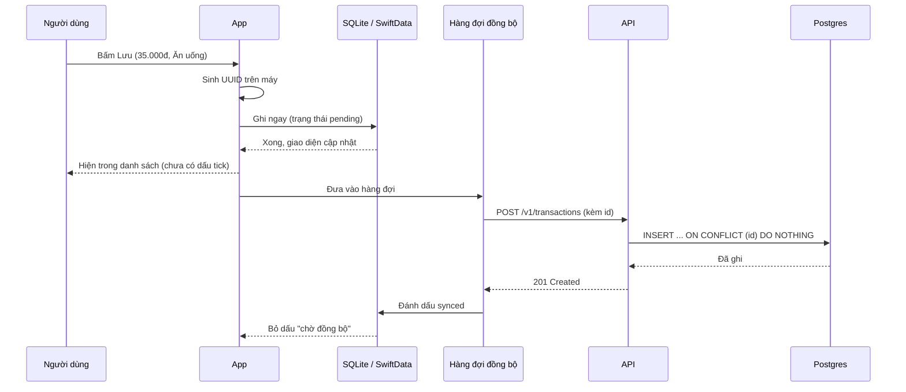
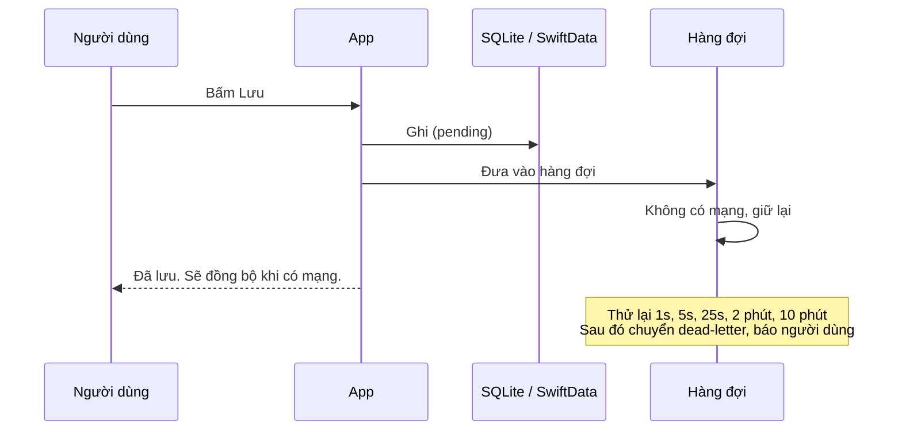
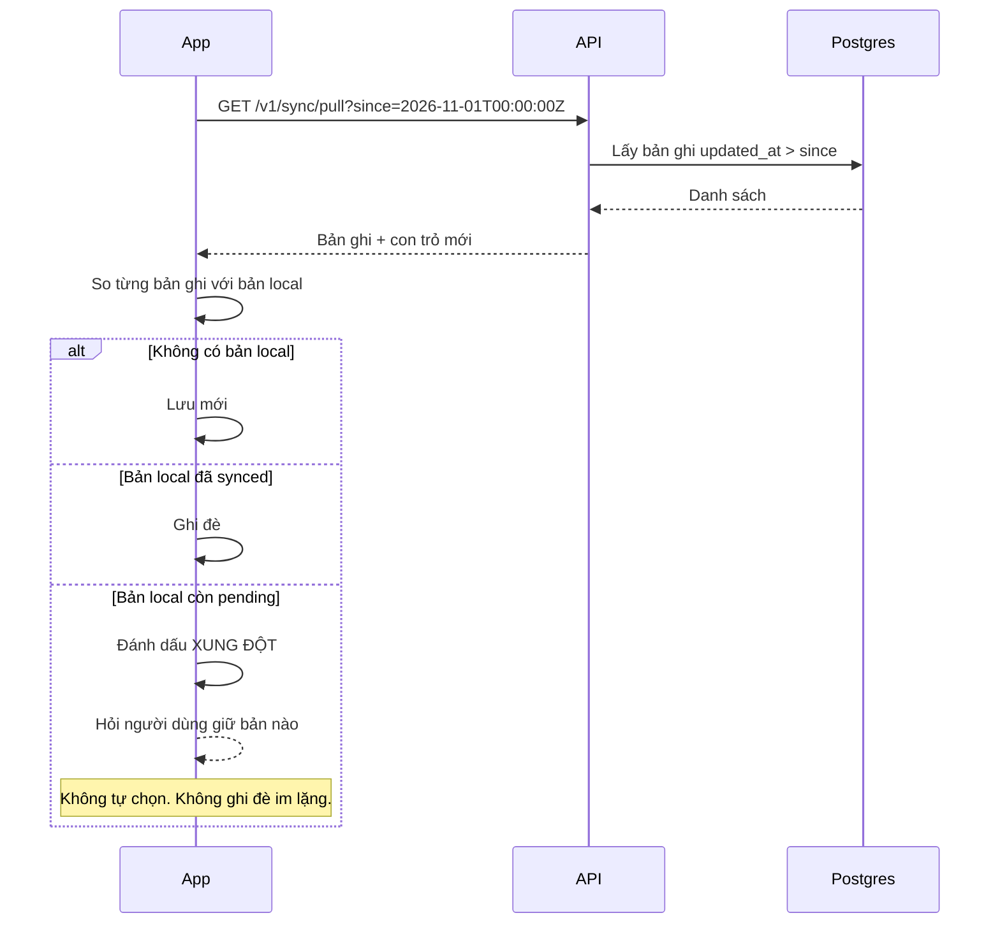
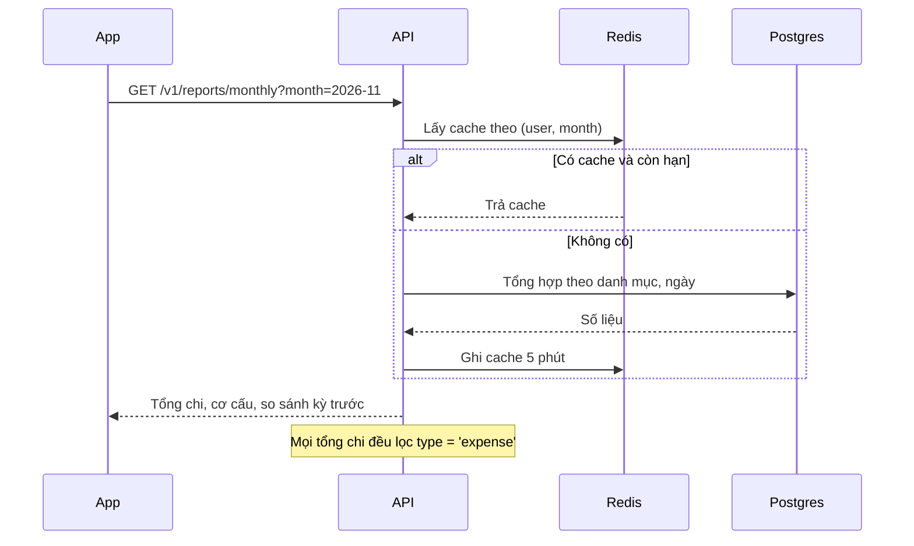
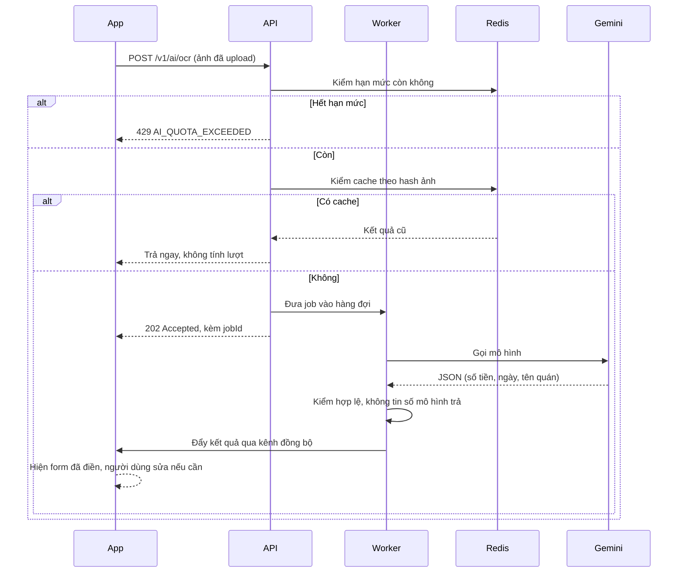
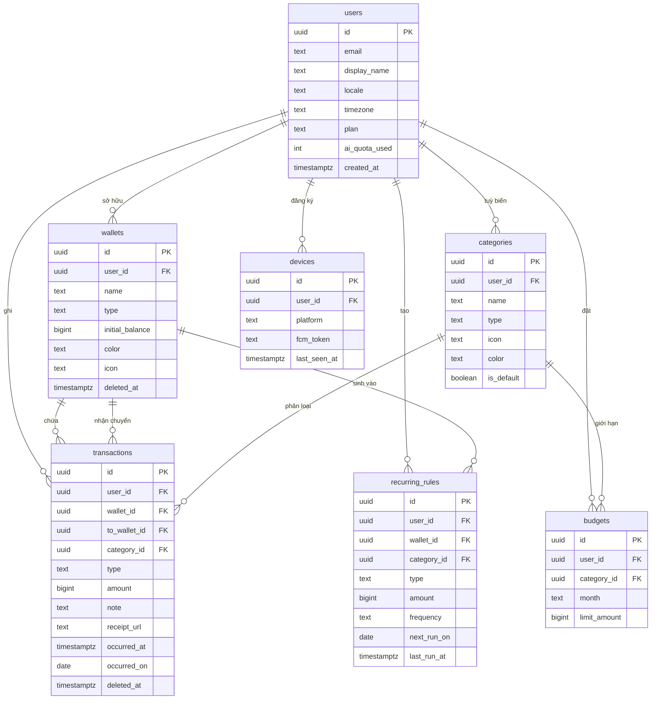

# 09 — Chi tiết kỹ thuật

**Phiên bản:** 2.0 · **Ngày:** 2026-11-16

Tài liệu này chứa chi tiết triển khai của hệ thống: phân tầng backend, luồng dữ liệu, quan hệ dữ liệu, quy trình tự động, yêu cầu phi chức năng, chi phí và rủi ro.

Tài liệu tổng quan hệ thống (mục tiêu, sơ đồ C4, cấu trúc repo, bảo mật, lộ trình) nằm ở [00-architecture.md](00-architecture.md).

---

## 1. Phân tầng backend

```
Request → Controller → Service → Repository → Postgres
              ↓           ↓           ↓
            DTO        Domain       Entity
                       logic
```

| Tầng | Trách nhiệm | Ví dụ |
|---|---|---|
| **Controller** | Nhận request, kiểm tra định dạng, gọi service, trả response | `TransactionsController.create()` |
| **Service** | Nghiệp vụ, giao dịch, gọi nhiều repository | `TransactionsService.create()` kiểm tra ví tồn tại, chặn số âm, chống trùng |
| **Repository** | Truy vấn dữ liệu, không chứa nghiệp vụ | `TransactionsRepository.findByMonth()` |
| **DTO** | Hình dạng dữ liệu vào/ra, có validate | `CreateTransactionDto` |
| **Guard** | Chặn trước khi vào controller | `JwtAuthGuard`, `SubscriptionGuard` |
| **Filter** | Bắt lỗi, đổi thành mã lỗi chuẩn | `ApiExceptionFilter` |
| **Interceptor** | Ghi log, đo thời gian, gắn mã truy vết | `LoggingInterceptor` |

### Quy tắc bắt buộc

| Quy tắc | Lý do |
|---|---|
| Controller không gọi thẳng Repository | Nếu không, nghiệp vụ phân tán, không test được |
| Repository không ném lỗi nghiệp vụ | Repo chỉ biết dữ liệu; lỗi nghiệp vụ do Service quyết |
| Service không biết `Request`/`Response` của HTTP | Để dùng lại được cho worker và cron |
| Mọi mã lỗi nằm trong một enum dùng chung | Client map theo mã, không đọc câu chữ |
| Không trả `message` của server cho người dùng cuối | Câu chữ thay đổi được; mã lỗi thì không |

---

## 2. Luồng dữ liệu

### 2.1 Ghi giao dịch khi có mạng



**Điểm quan trọng:** người dùng thấy phản hồi trước khi mạng trả lời. Nếu mạng hỏng ở bước cuối, bản ghi vẫn còn trên máy và tự gửi lại.

### 2.2 Ghi giao dịch khi không có mạng



### 2.3 Đồng bộ hai chiều và xử lý xung đột



### 2.4 Đọc báo cáo



### 2.5 Gọi AI (giai đoạn 2)



**Nguyên tắc bất di bất dịch:** mô hình AI không sinh ra con số tài chính. AI chỉ trích xuất từ ảnh; mọi tổng hợp do Postgres tính bằng công thức xác định.

---

## 3. Sơ đồ quan hệ dữ liệu



Chi tiết cột, kiểu, index, ràng buộc: xem [01-database-schema.md](01-database-schema.md).

**Ghi chú ERD:** bảng `goals` đã bị loại bỏ. Bảng `transactions` có hai khoá ngoại tới `wallets` — `wallet_id` (ví nguồn) và `to_wallet_id` (chỉ dùng khi `type = 'transfer'`).

---

## 4. Quy trình tự động

Toàn bộ chạy trên Worker NestJS + BullMQ, múi giờ `Asia/Ho_Chi_Minh`.
Mỗi job phải **chạy lại được** mà không tạo dữ liệu trùng.

### 4.1 Mười hai job định kỳ

| # | Job | Lịch | Việc làm | Khoá chống trùng | Khi lỗi |
|---|---|---|---|---|---|
| 1 | `recurring-generate` | `05 0 * * *` | Sinh giao dịch từ `recurring_rules` tới hạn, cập nhật `next_run_on` | `(rule_id, occurrence_date)` unique | Thử lại 3 lần, cách 5 phút |
| 2 | `budget-close` | `10 0 1 * *` | Chốt tổng tháng trước, tạo khung ngân sách tháng mới cho user đã đặt | `(user_id, month)` unique | Thử lại 3 lần |
| 3 | `aggregate-refresh` | `30 0 * * *` | Tính lại bảng tổng hợp tháng, ghi cache | Ghi đè theo `(user, month)` | Thử lại 3 lần |
| 4 | `budget-alert` | `*/15 * * * *` | Quét ngưỡng 70/90/100%, gửi thông báo | `(user, category, month, level)` unique | Bỏ qua lần này, lần sau quét lại |
| 5 | `daily-reminder` | `0 20 * * *` | Nhắc ghi chép, kèm số thật của ngày | 1 tin/người/ngày | Bỏ qua |
| 6 | `winback` | `0 9 * * *` | Quét người vắng 7 ngày và 14 ngày | Tối đa 2 lần/người, ghi vào `notifications` | Bỏ qua |
| 7 | `ai-monthly-review` | `0 6 1 * *` | Sinh nhận xét thói quen tháng trước | Chỉ user có ≥ 10 giao dịch | Thử lại 2 lần |
| 8 | `ai-quota-reset` | `0 0 1 * *` | Đặt lại `ai_quota_used = 0` theo gói | Idempotent theo tháng | Thử lại 3 lần |
| 9 | `ai-cost-breaker` | `0 * * * *` | Tổng chi phí AI giờ qua; vượt ngưỡng thì khoá tính năng tới đầu giờ sau | Khoá Redis có TTL | Gửi cảnh báo nếu chạy lỗi 2 lần |
| 10 | `fcm-token-cleanup` | `0 3 * * 0` | Xoá token FCM không hợp lệ | Idempotent | Thử lại 1 lần |
| 11 | `soft-delete-purge` | `30 3 * * *` | Xoá cứng bản ghi có `deleted_at` quá 30 ngày | Idempotent | Thử lại 3 lần |
| 12 | `integrity-check` | `0 4 * * 0` | Tìm dòng mồ côi, `amount <= 0`, tổng lệch giữa các bảng | Chỉ đọc | Gửi báo cáo cho nhóm |

### 4.2 Ba cơ chế không phải cron nhưng phải định nghĩa cùng lúc

| Cơ chế | Nội dung | Khi nào chạy |
|---|---|---|
| **Hàng đợi đồng bộ** | Thử lại cách 1s, 5s, 25s, 2 phút, 10 phút; sau đó dead-letter và báo người dùng | Mỗi lần client đẩy giao dịch |
| **Trigger toàn vẹn trong Postgres** | Cập nhật `updated_at`; chặn `amount <= 0`; chặn `type = 'transfer'` mà thiếu `to_wallet_id` | Mỗi lệnh ghi |
| **Cảnh báo vận hành** | Job nào lỗi 2 lần liên tiếp thì gửi thông báo cho nhóm qua email và Telegram | Sau mỗi lần job lỗi |

### 4.3 Vì sao không dùng pg_cron

| Cần | pg_cron | Worker + BullMQ |
|---|---|---|
| Thử lại có backoff | Không | Có |
| Dead-letter queue | Không | Có |
| Gọi API ngoài (Gemini, FCM) | Không (chỉ SQL) | Có |
| Chạy cục bộ để test | Không | Có |
| Log có cấu trúc | Không | Có |
| Tách theo múi giờ người dùng | Khó | Có |

### 4.4 Trình tự chạy trong một đêm

```mermaid
gantt
    title Các job ban đêm theo giờ Việt Nam
    dateFormat HH:mm
    axisFormat %H:%M
    section Dữ liệu
    recurring-generate   :00:05, 10m
    budget-close         :00:10, 20m
    aggregate-refresh    :00:30, 30m
    section Dọn dẹp
    soft-delete-purge    :03:30, 20m
    fcm-token-cleanup    :03:00, 15m
    section Định kỳ tuần
    integrity-check      :04:00, 30m
```



---

## 5. Yêu cầu phi chức năng

Mỗi con số dưới đây là ràng buộc có thể kiểm tra, không phải mong muốn chung chung.

| # | Yêu cầu | Con số đo được | Khi nào kiểm tra |
|---|---|---|---|
| NF1 | Mở app tới thấy số | Dưới 2 giây trên Android 4GB RAM | Máy thật chạy bằng 40 người |
| NF2 | Ghi một khoản chi khi có mạng | Dưới 1 giây kể từ bấm Lưu | Đo bằng timestamp local |
| NF3 | Ghi khi không có mạng | Luôn được; bản ghi hiện trong danh sách kèm dấu "chờ đồng bộ" | Rút mạng, thử 20 khoản |
| NF4 | Độ chính xác số | Tròn từng đồng; lệch 0đ sau 1.000 giao dịch so với tính tay | Test tự động |
| NF5 | Dung lượng DB trên máy | Dưới 1 MB cho 1 năm dữ liệu của 1 người | Đếm byte file SQLite |
| NF6 | Kích thước app Android | Dưới 40 MB | File build phát hành |
| NF7 | Dung lượng app iOS | Dưới 40 MB | File build phát hành |
| NF8 | Pin khi ghi 100 khoản | Ít hơn 2% | Đo qua 1 ngày thật |
| NF9 | Đồng bộ 1.000 giao dịch | Dưới 30 giây khi có mạng 4G | Test tải |
| NF10 | API p95 | Dưới 500 ms cho endpoint tổng hợp | Giám sát trong 4 tuần |
| NF11 | Tỷ lệ lỗi đồng bộ | Dưới 0,1% gói tin sau 4 tuần chạy thật | Giám sát |
| NF12 | Phục hồi khi mất DB | Dưới 1 giờ từ backup | Diễn tập 1 lần/tháng |

---


## 6. Chi phí hạ tầng theo quy mô

Giả định: gói miễn phí ở mức thấp nhất, tính theo hoá đơn thực tế.

| Quy mô người dùng | DB | Auth | Storage | API + Worker | Redis | AI | FCM | Tổng ước tính/tháng |
|---|---|---|---|---|---|---|---|---|
| 100 | 0 | 0 | 0 | 0 | 0 | ~44.000 | 0 | **~44.000** |
| 1.000 | 0 | 0 | 0 | 0 | 0 | ~440.000 | 0 | **~440.000** |
| 10.000 | 0–500.000 | 0–500.000 | 500.000 | 500.000 | 500.000 | ~4.400.000 | 0 | **~7.500.000** |
| 50.000 | 2.000.000 | 1.500.000 | 2.000.000 | 2.000.000 | 1.000.000 | ~22.000.000 | 0 | **~30.500.000** |

Lý do chi phí AI tăng nhanh hơn các thành phần khác: mỗi lượt gọi là một chi phí biến đổi theo người dùng, không phải theo máy chủ. Cầu dao chi phí (job 9) tồn tại để chặn trường hợp chi phí AI vượt doanh thu.

**Lưu ý:** con số AI dựa trên tỷ lệ user thực sự dùng AI, giả định khoảng 10% người dùng miễn phí dùng hết hạn mức. Cần đo thật trong 4 tuần đầu.

---

## 7. Rủi ro kỹ thuật

| Rủi ro | Xác suất | Tác động | Giảm thiểu |
|---|---|---|---|
| Hai codebase client lệch nhau | Cao | Cao | Một thư viện hợp đồng chia sẻ; kiểm thử đối chiếu số giữa ba nền |
| Liquid Glass không dùng được khi hạ mục tiêu iOS | Trung bình | Thấp | Fallback sang hiệu ứng kính mờ thường, không ảnh hưởng logic |
| 1 dev không kham nổi 3 nền trong 10 tuần | Cao | Cao | Cắt web trước; giữ iOS + Android; web để giai đoạn 2 |
| Supabase thay đổi chính sách giá | Thấp | Trung bình | Dữ liệu nằm trong Postgres chuẩn, không khoá chặt |
| Gemini đổi API hoặc giá | Trung bình | Thấp | Gọi qua một lớp trừu tượng; đổi cấu hình là đủ |
| RLS được tắt sai thao tác | Thấp | Rất cao | Test tự động kiểm tra RLS bật trên mọi bảng trong CI |
| Cron chạy trùng gây dữ liệu lặp | Trung bình | Cao | Khoá idempotent theo composite key; test job phải chạy lại được |
| Đồng bộ gây lệch số giữa thiết bị | Trung bình | Cao | Mỗi thiết bị giữ checkpoint; đối chiếu checksum theo tuần |

---
